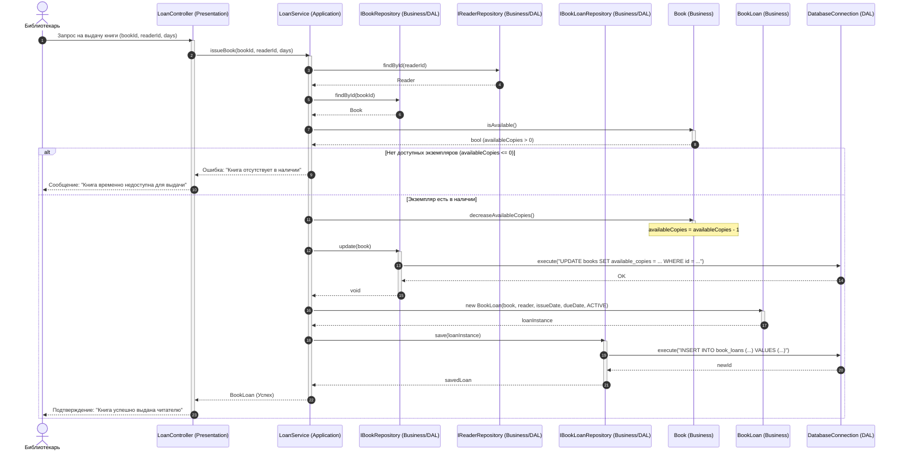

# Проектирование веб-приложения «Библиотечная система» (Вариант 4)

Архитектурное проектирование информационной системы для автоматизации библиотечных процессов в соответствии с принципами многоуровневой архитектуры (**Layered Architecture**), принципами **SOLID** и стандартами моделирования **UML 2.5**.

---

## Оглавление
1. [Описание предметной области и задачи](#1-описание-предметной-области-и-задачи)
   - [Основные возможности системы](#основные-возможности-системы)
2. [Архитектура приложения (Layered Architecture)](#2-архитектура-приложения-layered-architecture)
   - [Схема распределения слоев](#схема-распределения-слоев)
   - [Presentation Layer (Слой представления)](#presentation-layer-слой-представления)
   - [Application Layer (Слой приложения)](#application-layer-слой-приложения)
   - [Business Layer (Бизнес-слой / Модель)](#business-layer-бизнес-слой--модель)
   - [Data Access Layer (Слой доступа к данным / DAL)](#data-access-layer-слой-доступа-к-данным--dal)
   - [Таблица распределения компонентов по слоям](#таблица-распределения-компонентов-по-слоям)
3. [UML-диаграммы (Mermaid.js)](#3-uml-диаграммы-mermaidjs)
   - [Диаграмма классов (Class Diagram)](#диаграмма-классов-class-diagram)
   - [Диаграмма последовательности (Sequence Diagram)](#диаграмма-последовательности-sequence-diagram)
4. [Описание алгоритмов](#4-описание-алгоритмов)
   - [Алгоритм проверки доступности и выдачи книги](#алгоритм-проверки-доступности-и-выдачи-книги)
   - [Алгоритм возврата книги и закрытия займа](#алгоритм-возврата-книги-и-закрытия-займа)
   - [Алгоритм поиска просроченных книг и расчета дней задолженности](#алгоритм-поиска-просроченных-книг-и-расчета-дней-задолженности)
5. [Спецификация интерфейсов и структуры данных (DTO)](#5-спецификация-интерфейсов-и-структуры-данных-dto)
   - [Форматы передачи данных (DTO в формате JSON)](#форматы-передачи-данных-dto)
   - [Таблица взаимодействия эндпоинтов, сервисов и репозиториев](#таблица-взаимодействия-эндпоинтов-сервисов-и-репозиториев)
6. [Бизнес-правила системы](#6-бизнес-правила-системы)

---

## 1. Описание предметной области и задачи

Цель работы — спроектировать модульную архитектуру веб-приложения библиотеки без реализации серверного кода на языке PHP, базируясь на объектно-ориентированном проектировании и шаблоне Layered Architecture.

### Основные возможности системы:
* **Каталог книг:** ведение фонда изданий (название, автор, год издания, жанр, ISBN, общее и доступное количество экземпляров).
* **Учет читателей:** регистрация читателей библиотеки с сохранением ФИО, номера читательского билета, контактного телефона и email.
* **Поиск изданий:** поиск книг по ключевым словам, автору, жанру или уникальному номеру ISBN.
* **Выдача книг:** оформление выдачи экземпляра конкретному читателю с обязательной предварительной проверкой доступности свободного экземпляра (`availableCopies > 0`).
* **Возврат книг:** закрытие записи выдачи, фиксация даты фактического возврата и восстановление количества доступных экземпляров книги в фонде.
* **Мониторинг задолженностей:** автоматический поиск читателей с просроченными книгами и формирование сквозной истории выдач.

---

## 2. Архитектура приложения (Layered Architecture)

Система разделена на 4 изолированных слоя с однонаправленным потоком управления сверху вниз и инверсией зависимостей (**Dependency Inversion Principle**, SOLID: DIP):

### Схема распределения слоев

```
┌────────────────────────────────────────────────────────┐
│             PRESENTATION LAYER (Контроллеры)           │
│   Прием входящих HTTP-запросов (REST API / Web UI).    │
│   Валидация форматов входных параметров.               │
│   Формирование JSON / HTML ответов клиенту.            │
└───────────────────────────┬────────────────────────────┘
                            │ Вызовы Use Case / DTO
┌───────────────────────────▼────────────────────────────┐
│              APPLICATION LAYER (Сервисы логики)        │
│   Сервисы сценариев (BookService, LoanService и др.).  │
│   Координация шагов бизнес-процессов.                  │
│   Управление транзакциями и вызов методов сущностей.   │
└───────────────────────────┬────────────────────────────┘
                            │ Вызовы методов / Контракты
┌───────────────────────────▼────────────────────────────┐
│            BUSINESS LAYER (Сущности и Интерфейсы)      │
│   Сущности: Book, Author, Reader, BookLoan.            │
│   Инварианты и методы изменения состояния моделей.     │
│   Интерфейсы репозиториев (IBookRepository и др.).     │
└───────────────────────────▲────────────────────────────┘
                            │ Реализация интерфейсов (DIP)
┌───────────────────────────┴────────────────────────────┐
│             DATA ACCESS LAYER (DAL / Репозитории)      │
│   SqlBookRepository, SqlReaderRepository, SqlLoanRepo. │
│   Класс управления подключением DatabaseConnection.    │
│   ИНКАПСУЛЯЦИЯ: ВСЯ РАБОТА С БД И SQL ТОЛЬКО ЗДЕСЬ!    │
└────────────────────────────────────────────────────────┘
```

### Presentation Layer (Слой представления)
Служит внешней границей приложения:
* **`BookController`** — приём запросов на добавление книг в каталог, поиск по фильтрам и проверку доступности.
* **`ReaderController`** — приём запросов на регистрацию новых читателей и просмотр формуляра читателя.
* **`LoanController`** — приём запросов на выдачу книги, возврат, просмотр просроченных задолженностей и истории.

### Application Layer (Слой приложения)
Оркестрирует сценарии использования (Use Cases) библиотеки:
* **`BookService`** — сценарии каталога: создание книги, связывание с автором, поиск по критериям, проверка доступности экземпляров.
* **`ReaderService`** — сценарии читательского состава: регистрация читателя, проверка уникальности номера билета, получение активных выдач.
* **`LoanService`** — критические бизнес-сценарии: выдача книги (проверка свободного остатка $\rightarrow$ списание $\rightarrow$ создание займа), закрытие займа при возврате, получение списка должников.

### Business Layer (Бизнес-слой / Модель)
Ядро предметной области. Не зависит от внешних библиотек и базы данных:
* **`Book`** — сущность книги с полями `title`, `author`, `publicationYear`, `genre`, `isbn`, `totalCopies`, `availableCopies`. Содержит методы `isAvailable()`, `decreaseAvailableCopies()`, `increaseAvailableCopies()`.
* **`Author`** — данные об авторе книги (`fullName`, `country`, `birthDate`, `bio`).
* **`Reader`** — данные читателя (`fullName`, `libraryCardNumber`, `phone`, `email`).
* **`BookLoan`** — запись о выдаче (`book`, `reader`, `issueDate`, `dueDate`, `returnDate`, `status`). Содержит методы `closeLoan()`, `checkIsOverdue()`.
* **Интерфейсы репозиториев (`IBookRepository`, `IReaderRepository`, `IBookLoanRepository`, `IAuthorRepository`)** — контракты операций сохранения и выборки.

### Data Access Layer (Слой доступа к данным / DAL)
Единственный слой, ответственный за персистентность:
* **`DatabaseConnection`** — управление соединением с СУБД, выполнение подготовленных SQL-запросов и транзакций.
* **`Sql*Repository`** — классы, реализующие интерфейсы репозиториев. Здесь пишутся SQL-запросы (`SELECT`, `INSERT`, `UPDATE`), осуществляется гидратация строк таблиц в объекты доменных сущностей.

---

### Таблица распределения компонентов по слоям

| Слой | Компонент | Роль и зона ответственности |
|---|---|---|
| **Presentation** | `BookController` | HTTP-маршрутизация операций с книгами, валидация входных данных, формирование JSON |
| **Presentation** | `ReaderController` | Прием данных для регистрации читателя, вывод формуляра читателя |
| **Presentation** | `LoanController` | Эндпоинты выдачи, возврата, истории и фильтрации должников |
| **Application** | `BookService` | Логика каталога: добавление книг, поиск по критериям, проверка наличия |
| **Application** | `ReaderService` | Регистрация читателя, получение списка взятых им книг |
| **Application** | `LoanService` | Транзакционная выдача книги с декрементом остатка, возврат с инкрементом, выборка просрочек |
| **Business** | `Book`, `Author`, `Reader`, `BookLoan` | Сущности предметной области, хранение инвариантов и бизнес-правил |
| **Business** | `IBookRepository`, `IBookLoanRepository` и др. | Абстрактные интерфейсы хранилищ данных (DIP) |
| **Data Access** | `SqlBookRepository`, `SqlReaderRepository` | Генерация и выполнение SQL-запросов к БД (`books`, `readers`) |
| **Data Access** | `SqlBookLoanRepository` | SQL-запросы к таблице `book_loans` (JOIN с книгами и читателями) |
| **Data Access** | `DatabaseConnection` | Низкоуровневое соединение с СУБД (PDO / драйвер БД) |

---

## 3. UML-диаграммы (Mermaid.js)

### Диаграмма классов (Class Diagram)

```mermaid
classDiagram
    direction TB

    %% Перечисления
    class LoanStatus {
        <<enumeration>>
        ACTIVE
        RETURNED
        OVERDUE
    }

    %% Presentation Layer
    class BookController {
        -BookService bookService
        +addBook(request)
        +searchBooks(request)
        +checkAvailability(int bookId)
    }

    class ReaderController {
        -ReaderService readerService
        +registerReader(request)
        +getReaderLoans(int readerId)
    }

    class LoanController {
        -LoanService loanService
        +issueBook(request)
        +returnBook(request)
        +getOverdueLoans()
        +getLoanHistory()
    }

    %% Application Layer
    class BookService {
        -IBookRepository bookRepo
        -IAuthorRepository authorRepo
        +addBook(title, authorId, year, genre, isbn, totalCopies) Book
        +searchBooks(query) List~Book~
        +checkAvailability(int bookId) bool
    }

    class ReaderService {
        -IReaderRepository readerRepo
        -IBookLoanRepository loanRepo
        +registerReader(fullName, cardNumber, phone, email) Reader
        +getReaderActiveLoans(int readerId) List~BookLoan~
    }

    class LoanService {
        -IBookLoanRepository loanRepo
        -IBookRepository bookRepo
        -IReaderRepository readerRepo
        +issueBook(int bookId, int readerId, int days) BookLoan
        +returnBook(int loanId) BookLoan
        +getOverdueLoans() List~BookLoan~
        +getLoanHistory() List~BookLoan~
    }

    %% Business Layer
    class Book {
        +int id
        +string title
        +Author author
        +int publicationYear
        +string genre
        +string isbn
        +int totalCopies
        +int availableCopies
        +isAvailable() bool
        +decreaseAvailableCopies() void
        +increaseAvailableCopies() void
    }

    class Author {
        +int id
        +string fullName
        +string country
        +string birthDate
        +string bio
    }

    class Reader {
        +int id
        +string fullName
        +string libraryCardNumber
        +string phone
        +string email
    }

    class BookLoan {
        +int id
        +Book book
        +Reader reader
        +string issueDate
        +string dueDate
        +string returnDate
        +LoanStatus status
        +closeLoan(string returnDate) void
        +checkIsOverdue(string currentDate) bool
    }

    %% Контракты репозиториев
    class IBookRepository {
        <<interface>>
        +save(Book book) void
        +findById(int id) Book
        +findByIsbn(string isbn) Book
        +search(string query) List~Book~
        +update(Book book) void
    }

    class IAuthorRepository {
        <<interface>>
        +save(Author author) void
        +findById(int id) Author
    }

    class IReaderRepository {
        <<interface>>
        +save(Reader reader) void
        +findById(int id) Reader
    }

    class IBookLoanRepository {
        <<interface>>
        +save(BookLoan loan) void
        +findById(int id) BookLoan
        +update(BookLoan loan) void
        +findByReaderId(int readerId) List~BookLoan~
        +findOverdue() List~BookLoan~
        +findAll() List~BookLoan~
    }

    %% Data Access Layer (DAL)
    class DatabaseConnection {
        -string dsn
        +query(string sql, array params)
        +execute(string sql, array params)
    }

    class SqlBookRepository {
        -DatabaseConnection db
        +save(Book book) void
        +findById(int id) Book
        +findByIsbn(string isbn) Book
        +search(string query) List~Book~
        +update(Book book) void
    }

    class SqlAuthorRepository {
        -DatabaseConnection db
        +save(Author author) void
        +findById(int id) Author
    }

    class SqlReaderRepository {
        -DatabaseConnection db
        +save(Reader reader) void
        +findById(int id) Reader
    }

    class SqlBookLoanRepository {
        -DatabaseConnection db
        +save(BookLoan loan) void
        +findById(int id) BookLoan
        +update(BookLoan loan) void
        +findByReaderId(int readerId) List~BookLoan~
        +findOverdue() List~BookLoan~
        +findAll() List~BookLoan~
    }

    %% Связи
    BookController --> BookService
    ReaderController --> ReaderService
    LoanController --> LoanService

    BookService ..> IBookRepository
    BookService ..> IAuthorRepository
    ReaderService ..> IReaderRepository
    ReaderService ..> IBookLoanRepository
    LoanService ..> IBookLoanRepository
    LoanService ..> IBookRepository
    LoanService ..> IReaderRepository

    Book "0..*" o-- "1" Author : написана
    BookLoan "0..*" --> "1" Book : выдаваемая книга
    BookLoan "0..*" --> "1" Reader : читатель
    BookLoan --> LoanStatus

    SqlBookRepository ..|> IBookRepository
    SqlAuthorRepository ..|> IAuthorRepository
    SqlReaderRepository ..|> IReaderRepository
    SqlBookLoanRepository ..|> IBookLoanRepository

    SqlBookRepository --> DatabaseConnection
    SqlAuthorRepository --> DatabaseConnection
    SqlReaderRepository --> DatabaseConnection
    SqlBookLoanRepository --> DatabaseConnection
```



---

### Диаграмма последовательности (Sequence Diagram)

Сценарий: **«Выдача книги читателю»** с предварительной проверкой наличия свободного экземпляра, уменьшением остатка и сохранением в DAL.



---

## 4. Описание алгоритмов

### Алгоритм проверки доступности и выдачи книги

#### Логика работы
1. Получается экземпляр книги из репозитория по `bookId`.
2. Проверяется инвариант доступности: экземпляр доступен, если `availableCopies > 0`.
3. Если экземпляров нет, операция отклоняется.
4. Если экземпляр доступен, счетчик доступных книг уменьшается на 1 (`availableCopies = availableCopies - 1`).
5. Запись книги обновляется в БД, после чего создается и сохраняется запись `BookLoan` с плановой датой возврата `dueDate = issueDate + days`.

#### Псевдокод функции выдачи:

```text
функция issueBook(bookId, readerId, durationDays):
    читатель = ReaderRepository.findById(readerId)
    если читатель == NULL то:
        вернуть Ошибка("Читатель не найден")

    книга = BookRepository.findById(bookId)
    если книга == NULL то:
        вернуть Ошибка("Книга не найдена")

    // Проверка доступности свободного экземпляра
    если книга.availableCopies <= 0 то:
        вернуть Ошибка("Нет доступных экземпляров для выдачи")

    // Уменьшение количества свободных экземпляров
    книга.availableCopies = книга.availableCopies - 1
    BookRepository.update(книга)

    // Создание записи займа
    датаВыдачи = текущаяДата()
    планВозврата = датаВыдачи + durationDays
    запись = создать BookLoan(книга, читатель, датаВыдачи, планВозврата, статус="ACTIVE")
    BookLoanRepository.save(запись)

    вернуть запись
```

---

### Алгоритм возврата книги и закрытия займа

#### Логика работы
1. По идентификатору займа `loanId` извлекается запись `BookLoan`.
2. Проверяется статус: если книга уже возвращена (`status == "RETURNED"`), возвращается ошибка повторного закрытия.
3. Фиксируется фактическая дата возврата `returnDate = текущаяДата()`, статус переводится в `RETURNED`.
4. В сущности книги увеличивается количество доступных копий: `availableCopies = availableCopies + 1` (при условии, что `availableCopies < totalCopies`).
5. Изменения фиксируются в БД.

#### Псевдокод возврата:

```text
функция returnBook(loanId):
    запись = BookLoanRepository.findById(loanId)
    если запись == NULL то:
        вернуть Ошибка("Запись выдачи не найдена")

    если запись.status == "RETURNED" то:
        вернуть Ошибка("Книга уже была возвращена")

    книга = BookRepository.findById(запись.book.id)

    // Восстановление баланса экземпляров
    если книга.availableCopies < книга.totalCopies то:
        книга.availableCopies = книга.availableCopies + 1
        BookRepository.update(книга)

    // Закрытие записи выдачи
    запись.returnDate = текущаяДата()
    запись.status = "RETURNED"
    BookLoanRepository.update(запись)

    вернуть запись
```

---

### Алгоритм поиска просроченных книг и расчета дней задолженности

#### Логика работы
1. Отбираются все записи о выдачах со статусом `ACTIVE`.
2. Для каждой записи проверяется условие просрочки: $\text{текущаяДата} > \text{dueDate}$.
3. Вычисляется количество дней просрочки по формуле:
   $$\text{ДнейПросрочки} = \text{ТекущаяДата} - \text{ПлановаяДатаВозврата}$$
4. Если задолженность обнаружена, статус меняется на `OVERDUE` и формируется отчет для библиотекаря.

#### Псевдокод проверки просрочек:

```text
функция getOverdueLoans():
    сегодня = текущаяДата()
    всеВыдачи = BookLoanRepository.findAll()
    списокПросрочек = []

    для каждой записи из всеВыдачи:
        если запись.status != "RETURNED" то:
            если сегодня > запись.dueDate то:
                запись.status = "OVERDUE"
                дней = дниМежду(запись.dueDate, сегодня)
                добавитьВСписок(списокПросрочек, {
                    "loanId": запись.id,
                    "bookTitle": запись.book.title,
                    "readerName": запись.reader.fullName,
                    "phone": запись.reader.phone,
                    "overdueDays": дней
                })

    вернуть списокПросрочек
```

---

## 5. Спецификация интерфейсов и структуры данных (DTO)

Для взаимодействия между слоями используются простые структуры передачи данных (DTO).

### Форматы передачи данных (DTO)

```json
// Данные для добавления книги (CreateBookDTO)
{
  "title": "Чистый код",
  "authorId": 14,
  "publicationYear": 2019,
  "genre": "Компьютерная литература",
  "isbn": "978-5-4461-0960-9",
  "totalCopies": 5
}

// Карточка книги в каталоге (BookResponseDTO)
{
  "id": 101,
  "title": "Чистый код",
  "author": "Роберт Мартин",
  "genre": "Компьютерная литература",
  "isbn": "978-5-4461-0960-9",
  "totalCopies": 5,
  "availableCopies": 3,
  "isAvailable": true
}

// Запись о выдаче книги (LoanResponseDTO)
{
  "loanId": 502,
  "bookTitle": "Чистый код",
  "readerName": "Иванов Иван Иванович",
  "libraryCardNumber": "LC-2024-0012",
  "issueDate": "2026-11-01",
  "dueDate": "2026-11-15",
  "returnDate": null,
  "status": "ACTIVE"
}
```

### Таблица взаимодействия эндпоинтов, сервисов и репозиториев

| Маршрут / Действие | Контроллер | Сервис (Application) | Репозиторий (DAL) | SQL-операция |
|---|---|---|---|---|
| `POST /books` | `BookController.addBook()` | `BookService.addBook()` | `SqlBookRepository.save()` | `INSERT INTO books ...` |
| `GET /books/search?q=` | `BookController.searchBooks()` | `BookService.searchBooks()` | `SqlBookRepository.search()` | `SELECT * FROM books WHERE ...` |
| `GET /books/{id}/status`| `BookController.checkAvailability()`| `BookService.checkAvailability()`| `SqlBookRepository.findById()` | `SELECT available_copies ...` |
| `POST /readers` | `ReaderController.registerReader()`| `ReaderService.registerReader()` | `SqlReaderRepository.save()` | `INSERT INTO readers ...` |
| `GET /readers/{id}/loans`| `ReaderController.getReaderLoans()`| `ReaderService.getReaderActiveLoans()`| `SqlBookLoanRepository.findByReaderId()` | `SELECT * FROM book_loans WHERE ...` |
| `POST /loans` | `LoanController.issueBook()` | `LoanService.issueBook()` | `SqlBookRepository.update()`, `SqlBookLoanRepository.save()` | `UPDATE books ...`, `INSERT INTO book_loans ...` |
| `POST /loans/{id}/return`| `LoanController.returnBook()` | `LoanService.returnBook()` | `SqlBookRepository.update()`, `SqlBookLoanRepository.update()` | `UPDATE books ...`, `UPDATE book_loans ...` |
| `GET /loans/overdue` | `LoanController.getOverdueLoans()` | `LoanService.getOverdueLoans()` | `SqlBookLoanRepository.findOverdue()` | `SELECT * FROM book_loans WHERE due_date < NOW()` |
| `GET /loans/history` | `LoanController.getLoanHistory()` | `LoanService.getLoanHistory()` | `SqlBookLoanRepository.findAll()` | `SELECT * FROM book_loans ORDER BY id DESC` |

---

## 6. Бизнес-правила системы

1. **Неотрицательный остаток:** Количество доступных экземпляров книги `availableCopies` не может быть отрицательным:
   $$0 \le availableCopies \le totalCopies$$
2. **Запрет выдачи при отсутствии экземпляра:** Если $availableCopies = 0$, выдача книги блокируется на уровне доменной логики с возвратом понятного сообщения об ошибке.
3. **Изоляция базы данных:** Контроллеры и сервисы **не содержат SQL-запросов**. Все операции с таблицами БД инкапсулированы исключительно в классах слоя `Data Access Layer` (`Sql*Repository`).
4. **Слабая связанность (DIP):** Слой приложения взаимодействует с репозиториями через интерфейсы (`IBookRepository`, `IBookLoanRepository` и др.), что позволяет при необходимости подменить реляционную СУБД без изменения бизнес-логики.
5. **Целостность истории выдач:** Записи в таблице `book_loans` никогда не удаляются физически — при возврате книги фиксируется дата `returnDate`, а статус изменяется на `RETURNED`.
