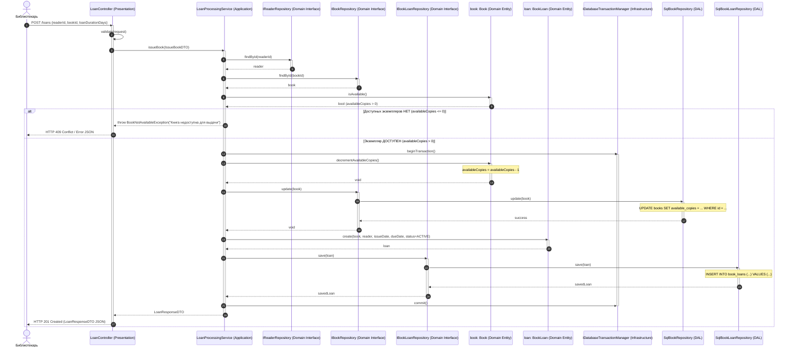

# Веб-приложение «Библиотечная система» (Вариант 4)

Архитектурное проектирование информационной системы библиотеки в соответствии с принципами многоуровневой архитектуры (**Layered Architecture**), принципами **SOLID** и стандартами моделирования **UML 2.5**.

---

## 1. Описание предметной области и цели системы

Информационная система предназначена для автоматизации ключевых бизнес-процессов современной библиотеки:
- Ведение электронного каталога изданий и информации об авторах.
- Учёт номерного фонда читательских билетов и контактных данных читателей.
- Контроль наличия физических экземпляров книг (общее и доступное количество).
- Регистрация выдачи книг с проверкой доступности свободного экземпляра.
- Фиксация возврата книг с автоматическим восстановлением баланса доступных экземпляров.
- Мониторинг просроченных задолженностей и хранение сквозной истории выдач.

---

## 2. Архитектурный стиль (Layered Architecture)

Система строго разделена на 4 независимых слоя с нисходящим потоком управления и инверсией зависимостей (**Dependency Inversion Principle**, SOLID: DIP):

```
+-------------------------------------------------------------+
|                     Presentation Layer                      |
|      (Controllers, Web Routes, Request Validation, Views)   |
+-------------------------------------------------------------+
                              |
                              v
+-------------------------------------------------------------+
|                      Application Layer                      |
|       (Application Services, Use Cases, Orchestration, DTO) |
+-------------------------------------------------------------+
                              |
                              v
+-------------------------------------------------------------+
|                       Business Layer                        |
|   (Domain Entities, Invariants, Repository Interfaces, Enums)|
+-------------------------------------------------------------+
                              ^
                              | (implements interfaces)
+-------------------------------------------------------------+
|                     Data Access Layer                       |
|   (SQL Repositories, PDO/Connection Context, Transactions)  |
+-------------------------------------------------------------+
```

### Принципы изоляции слоев:
1. **Presentation Layer**: Не содержит бизнес-правил и прямых запросов к БД. Отвечает только за протокол взаимодействия (HTTP/REST), сериализацию и валидацию формата данных.
2. **Application Layer**: Не выполняет SQL-запросов напрямую. Координирует выполнение сценариев, управляет транзакциями через интерфейс менеджера транзакций и вызывает методы бизнес-сущностей.
3. **Business (Domain) Layer**: Ядро системы. Содержит сущности (`Book`, `Author`, `Reader`, `BookLoan`) и контракты репозиториев (`IBookRepository` и др.). Не имеет внешних зависимостей.
4. **Data Access Layer (DAL)**: **Единственный слой, в котором разрешены SQL-запросы и взаимодействие с СУБД**. Реализует контракты репозиториев из Business Layer.

---

## 3. Сущности и атрибутивный состав

| Сущность | Атрибуты | Описание и инварианты |
| :--- | :--- | :--- |
| **`Book`** | `id: int`<br>`title: string`<br>`author: Author`<br>`publicationYear: int`<br>`genre: string`<br>`isbn: string`<br>`totalCopies: int`<br>`availableCopies: int` | Книга в фонде. Инвариант: `0 <= availableCopies <= totalCopies`. Выдача возможна только при `availableCopies > 0`. |
| **`Author`** | `id: int`<br>`fullName: string`<br>`country: string`<br>`birthDate: DateTime`<br>`bio: string` | Автор произведений. Связан отношением «один-ко-многим» с сущностью `Book`. |
| **`Reader`** | `id: int`<br>`fullName: string`<br>`libraryCardNumber: string`<br>`phone: string`<br>`email: string` | Читатель библиотеки. Уникальный номер читательского билета. |
| **`BookLoan`** | `id: int`<br>`book: Book`<br>`reader: Reader`<br>`issueDate: DateTime`<br>`dueDate: DateTime`<br>`returnDate: ?DateTime`<br>`status: LoanStatus` | Запись о выдаче книги. Статусы: `ACTIVE`, `RETURNED`, `OVERDUE`. При закрытии записи фиксируется `returnDate`. |

---

## 4. Обязательные бизнес-операции и их распределение

1. **Добавление книги**: `BookController` -> `BookCatalogService.addBook(CreateBookDTO)` -> `IBookRepository.save(Book)`.
2. **Регистрация читателя**: `ReaderController` -> `ReaderManagementService.registerReader(RegisterReaderDTO)` -> `IReaderRepository.save(Reader)`.
3. **Поиск книги**: `BookController` -> `BookCatalogService.searchBooks(BookSearchFilterDTO)` -> `IBookRepository.findByCriteria(...)`.
4. **Выдача книги**: `LoanController` -> `LoanProcessingService.issueBook(IssueBookDTO)` -> `Book.decrementAvailableCopies()` -> `IBookLoanRepository.save(BookLoan)`.
5. **Возврат книги**: `LoanController` -> `LoanProcessingService.returnBook(ReturnBookDTO)` -> `BookLoan.close()` -> `Book.incrementAvailableCopies()` -> `IBookRepository.update()`.
6. **Проверка доступности книги**: `BookController` -> `BookCatalogService.checkAvailability(bookId)` -> `Book.isAvailable()`.
7. **Получение списка книг конкретного читателя**: `ReaderController` -> `ReaderManagementService.getReaderActiveLoans(readerId)` -> `IBookLoanRepository.findActiveByReaderId(readerId)`.
8. **Получение истории выдач**: `LoanController` -> `LoanProcessingService.getLoanHistory(filter)` -> `IBookLoanRepository.findAll(filter)`.
9. **Получение списка просроченных книг**: `LoanController` -> `LoanProcessingService.getOverdueLoans()` -> `IBookLoanRepository.findOverdueLoans(now)`.

---

## 5. UML-диаграммы (Mermaid.js)

### 5.1. Диаграмма классов (Class Diagram)

```mermaid
classDiagram
    direction TB

    %% Presentation Layer
    class BookController {
        -BookCatalogService bookCatalogService
        +addBook(Request request) JsonResponse
        +searchBooks(Request request) JsonResponse
        +checkAvailability(int bookId) JsonResponse
    }

    class ReaderController {
        -ReaderManagementService readerService
        +registerReader(Request request) JsonResponse
        +getReaderLoans(int readerId) JsonResponse
    }

    class LoanController {
        -LoanProcessingService loanService
        +issueBook(Request request) JsonResponse
        +returnBook(Request request) JsonResponse
        +getOverdueLoans() JsonResponse
        +getLoanHistory(Request request) JsonResponse
    }

    %% Application Layer
    class BookCatalogService {
        -IBookRepository bookRepo
        -IAuthorRepository authorRepo
        +addBook(CreateBookDTO dto) BookResponseDTO
        +searchBooks(BookSearchFilterDTO filter) List~BookResponseDTO~
        +checkAvailability(int bookId) bool
    }

    class ReaderManagementService {
        -IReaderRepository readerRepo
        -IBookLoanRepository loanRepo
        +registerReader(RegisterReaderDTO dto) ReaderResponseDTO
        +getReaderActiveLoans(int readerId) List~LoanResponseDTO~
    }

    class LoanProcessingService {
        -IBookLoanRepository loanRepo
        -IBookRepository bookRepo
        -IReaderRepository readerRepo
        -IDatabaseTransactionManager txManager
        +issueBook(IssueBookDTO dto) LoanResponseDTO
        +returnBook(ReturnBookDTO dto) LoanResponseDTO
        +getOverdueLoans() List~LoanResponseDTO~
        +getLoanHistory(LoanHistoryFilterDTO filter) List~LoanResponseDTO~
    }

    class IssueBookDTO {
        +int bookId
        +int readerId
        +int loanDurationDays
    }

    class ReturnBookDTO {
        +int loanId
        +DateTime returnDate
    }

    class CreateBookDTO {
        +string title
        +int authorId
        +int publicationYear
        +string genre
        +string isbn
        +int totalCopies
    }

    class RegisterReaderDTO {
        +string fullName
        +string libraryCardNumber
        +string phone
        +string email
    }

    %% Business Layer
    class Book {
        -int id
        -string title
        -Author author
        -int publicationYear
        -string genre
        -string isbn
        -int totalCopies
        -int availableCopies
        +isAvailable() bool
        +decrementAvailableCopies() void
        +incrementAvailableCopies() void
        +getId() int
        +getTitle() string
        +getAvailableCopies() int
        +getTotalCopies() int
    }

    class Author {
        -int id
        -string fullName
        -string country
        -DateTime birthDate
        -string bio
        +getId() int
        +getFullName() string
    }

    class Reader {
        -int id
        -string fullName
        -string libraryCardNumber
        -string phone
        -string email
        +getId() int
        +getLibraryCardNumber() string
        +canBorrow() bool
    }

    class BookLoan {
        -int id
        -Book book
        -Reader reader
        -DateTime issueDate
        -DateTime dueDate
        -DateTime returnDate
        -LoanStatus status
        +close(DateTime actualReturnDate) void
        +isOverdue(DateTime currentDate) bool
        +getId() int
        +getStatus() LoanStatus
        +getDueDate() DateTime
    }

    class LoanStatus {
        <<enumeration>>
        ACTIVE
        RETURNED
        OVERDUE
    }

    class IBookRepository {
        <<interface>>
        +save(Book book) Book
        +findById(int id) Book
        +findByIsbn(string isbn) Book
        +findByCriteria(BookSearchFilterDTO filter) List~Book~
        +update(Book book) void
    }

    class IAuthorRepository {
        <<interface>>
        +save(Author author) Author
        +findById(int id) Author
    }

    class IReaderRepository {
        <<interface>>
        +save(Reader reader) Reader
        +findById(int id) Reader
        +findByCardNumber(string cardNumber) Reader
    }

    class IBookLoanRepository {
        <<interface>>
        +save(BookLoan loan) BookLoan
        +findById(int id) BookLoan
        +update(BookLoan loan) void
        +findActiveByReaderId(int readerId) List~BookLoan~
        +findOverdueLoans(DateTime currentDate) List~BookLoan~
        +findAll(LoanHistoryFilterDTO filter) List~BookLoan~
    }

    class IDatabaseTransactionManager {
        <<interface>>
        +beginTransaction() void
        +commit() void
        +rollback() void
    }

    %% Data Access Layer
    class DatabaseContext {
        -Connection connection
        +execute(string sql, array params) Result
        +beginTransaction() void
        +commit() void
        +rollback() void
    }

    class SqlBookRepository {
        -DatabaseContext db
        +save(Book book) Book
        +findById(int id) Book
        +findByIsbn(string isbn) Book
        +findByCriteria(BookSearchFilterDTO filter) List~Book~
        +update(Book book) void
    }

    class SqlAuthorRepository {
        -DatabaseContext db
        +save(Author author) Author
        +findById(int id) Author
    }

    class SqlReaderRepository {
        -DatabaseContext db
        +save(Reader reader) Reader
        +findById(int id) Reader
        +findByCardNumber(string cardNumber) Reader
    }

    class SqlBookLoanRepository {
        -DatabaseContext db
        +save(BookLoan loan) BookLoan
        +findById(int id) BookLoan
        +update(BookLoan loan) void
        +findActiveByReaderId(int readerId) List~BookLoan~
        +findOverdueLoans(DateTime currentDate) List~BookLoan~
        +findAll(LoanHistoryFilterDTO filter) List~BookLoan~
    }

    %% Dependencies
    BookController --> BookCatalogService
    ReaderController --> ReaderManagementService
    LoanController --> LoanProcessingService

    BookCatalogService ..> IBookRepository
    BookCatalogService ..> IAuthorRepository
    ReaderManagementService ..> IReaderRepository
    ReaderManagementService ..> IBookLoanRepository
    LoanProcessingService ..> IBookLoanRepository
    LoanProcessingService ..> IBookRepository
    LoanProcessingService ..> IReaderRepository
    LoanProcessingService ..> IDatabaseTransactionManager

    LoanProcessingService ..> IssueBookDTO
    LoanProcessingService ..> ReturnBookDTO

    Book "0..*" o-- "1" Author
    BookLoan "0..*" --> "1" Book
    BookLoan "0..*" --> "1" Reader
    BookLoan --> LoanStatus

    SqlBookRepository ..|> IBookRepository
    SqlAuthorRepository ..|> IAuthorRepository
    SqlReaderRepository ..|> IReaderRepository
    SqlBookLoanRepository ..|> IBookLoanRepository
    DatabaseContext ..|> IDatabaseTransactionManager

    SqlBookRepository --> DatabaseContext
    SqlAuthorRepository --> DatabaseContext
    SqlReaderRepository --> DatabaseContext
    SqlBookLoanRepository --> DatabaseContext
```



---

### 5.2. Диаграмма последовательности: Выдача книги (Sequence Diagram)



---

## 6. Технологический стек и проектные соглашения

- **Методология моделирования**: UML 2.5 (Mermaid.js).
- **Архитектурный шаблон**: 4-Layered Architecture (Presentation -> Application -> Business/Domain <- Data Access).
- **СУБД (проектируемая)**: Реляционная СУБД (PostgreSQL / MySQL). Все запросы и работа с транзакциями изолированы в `Data Access Layer`.
- **Контроль версий**: Git Flow с ветками `main` и `dev`, интеграция через Pull Request.
