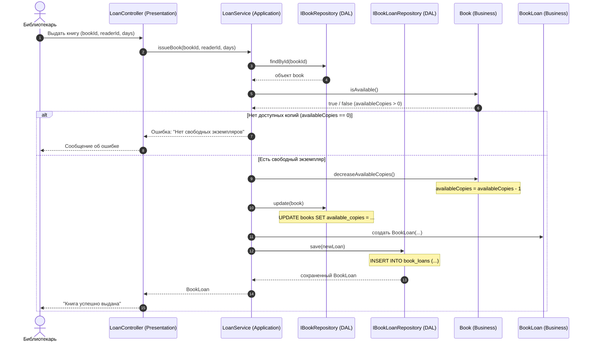

# Лабораторная работа: Библиотечная система (Вариант 4)

**Тема:** Архитектурное проектирование веб-приложения на основе многоуровневой архитектуры (Layered Architecture).  
**Выполнил:** студент Бабаян Тигран  
**Вариант:** 4 (Информационная система библиотеки)

---

## 1. Цель работы
Спроектировать архитектуру информационной системы «Библиотека» в соответствии с шаблоном Layered Architecture (4 слоя) без реализации кода, используя язык моделирования UML и диаграммы Mermaid.js.

---

## 2. Описание предметной области
Система предназначена для автоматизации работы библиотеки:
- ведение каталога книг и авторов;
- учет читателей и номеров читательских билетов;
- отслеживание общего и доступного количества экземпляров каждой книги;
- выдача книг читателям с проверкой, есть ли свободные экземпляры;
- возврат книг с увеличением количества доступных копий;
- отслеживание истории выдач и поиск просроченных книг.

---

## 3. Архитектура приложения (4 слоя)

В соответствии с заданием архитектура разделена на 4 слоя:

1. **Presentation Layer (Слой представления):**
   - Контроллеры (`BookController`, `ReaderController`, `LoanController`).
   - Принимают HTTP-запросы от пользователя/библиотекаря, проверяют входные данные и возвращают ответ (JSON / представление). Не содержат бизнес-логики и SQL-запросов.

2. **Application Layer (Слой приложения / Сервисы):**
   - Сервисы (`BookService`, `ReaderService`, `LoanService`).
   - Отвечают за логику сценариев приложения: вызывают нужные сущности, проверяют условия (например, доступность книги), обращаются к интерфейсам репозиториев.

3. **Business Layer (Бизнес-слой / Домен):**
   - Основные сущности системы: `Book`, `Author`, `Reader`, `BookLoan`, статус `LoanStatus`.
   - Содержат поля и методы для изменения своего состояния (например, `decreaseAvailableCopies()`, `isAvailable()`).
   - Содержит интерфейсы репозиториев (`IBookRepository` и др.), чтобы слой приложения не зависел от базы данных напрямую.

4. **Data Access Layer (DAL, Слой доступа к данным):**
   - Классы `SqlBookRepository`, `SqlReaderRepository`, `SqlBookLoanRepository`, `SqlAuthorRepository` и `DatabaseConnection`.
   - **Вся работа с базой данных и SQL-запросы находятся строго в этом слое**. Репозитории реализуют интерфейсы из бизнес-слоя.

### Таблица распределения компонентов по слоям

| Слой | Классы | Обязанности |
| :--- | :--- | :--- |
| **Presentation** | `BookController`, `ReaderController`, `LoanController` | Прием HTTP-запросов, вызов сервисов, возврат ответа |
| **Application** | `BookService`, `ReaderService`, `LoanService` | Управление операциями выдачи, возврата, поиска и регистрации |
| **Business** | `Book`, `Author`, `Reader`, `BookLoan`, интерфейсы `IBookRepository`, `IReaderRepository`, `IBookLoanRepository`, `IAuthorRepository` | Данные сущностей, проверка доступности экземпляра, интерфейсы |
| **Data Access (DAL)** | `SqlBookRepository`, `SqlReaderRepository`, `SqlBookLoanRepository`, `SqlAuthorRepository`, `DatabaseConnection` | Выполнение SQL-запросов (SELECT, INSERT, UPDATE) к базе данных |

---

## 4. Сущности системы

- **Book (Книга):**
  - `id`: идентификатор
  - `title`: название книги
  - `author`: автор (объект Author)
  - `publicationYear`: год издания
  - `genre`: жанр
  - `isbn`: номер ISBN
  - `totalCopies`: всего экземпляров в библиотеке
  - `availableCopies`: количество доступных сейчас экземпляров (не может быть меньше 0)
- **Author (Автор):**
  - `id`: идентификатор
  - `fullName`: ФИО автора
  - `country`: страна
  - `birthDate`: дата рождения
  - `bio`: краткая биография
- **Reader (Читатель):**
  - `id`: идентификатор
  - `fullName`: ФИО читателя
  - `libraryCardNumber`: номер читательского билета
  - `phone`: телефон
  - `email`: электронная почта
- **BookLoan (Выдача книги):**
  - `id`: идентификатор записи
  - `book`: выданная книга
  - `reader`: читатель
  - `issueDate`: дата выдачи
  - `dueDate`: плановая дата возврата
  - `returnDate`: фактическая дата возврата (null, если книга еще на руках)
  - `status`: статус (`ACTIVE`, `RETURNED`, `OVERDUE`)

---

## 5. Выполнение 9 обязательных операций

1. **Добавление книги:** `BookController` -> `BookService.addBook()` -> `IBookRepository.save()`.
2. **Регистрация читателя:** `ReaderController` -> `ReaderService.registerReader()` -> `IReaderRepository.save()`.
3. **Поиск книги:** `BookController` -> `BookService.searchBooks()` -> `IBookRepository.search()`.
4. **Выдача книги:** `LoanController` -> `LoanService.issueBook()`:
   - сервис проверяет доступность через `book.isAvailable()`;
   - если копий нет, выдается ошибка;
   - если есть, уменьшается `book.availableCopies`, сохраняется запись в `BookLoan` и обновляется книга в БД.
5. **Возврат книги:** `LoanController` -> `LoanService.returnBook()` -> закрывается запись выдачи, вызывается `book.increaseAvailableCopies()`, изменения сохраняются в БД.
6. **Проверка доступности книги:** `BookController` -> `BookService.checkAvailability()` -> `book.isAvailable()`.
7. **Получение списка книг читателя:** `ReaderController` -> `ReaderService.getReaderActiveLoans()` -> `IBookLoanRepository.findByReaderId()`.
8. **Получение истории выдач:** `LoanController` -> `LoanService.getLoanHistory()` -> `IBookLoanRepository.findAll()`.
9. **Получение списка просроченных книг:** `LoanController` -> `LoanService.getOverdueLoans()` -> `IBookLoanRepository.findOverdue()`.

---

## 6. UML-диаграммы

### 6.1. Диаграмма классов (Class Diagram)

```mermaid
classDiagram
    direction TB

    %% 1. Presentation Layer
    class BookController {
        -BookService bookService
        +addBook(request)
        +searchBooks(request)
        +checkAvailability(bookId)
    }

    class ReaderController {
        -ReaderService readerService
        +registerReader(request)
        +getReaderBooks(readerId)
    }

    class LoanController {
        -LoanService loanService
        +issueBook(request)
        +returnBook(request)
        +getOverdueLoans()
        +getLoanHistory()
    }

    %% 2. Application Layer
    class BookService {
        -IBookRepository bookRepo
        -IAuthorRepository authorRepo
        +addBook(title, authorId, year, genre, isbn, totalCopies) Book
        +searchBooks(query) List~Book~
        +checkAvailability(bookId) bool
    }

    class ReaderService {
        -IReaderRepository readerRepo
        -IBookLoanRepository loanRepo
        +registerReader(fullName, cardNumber, phone, email) Reader
        +getReaderActiveLoans(readerId) List~BookLoan~
    }

    class LoanService {
        -IBookLoanRepository loanRepo
        -IBookRepository bookRepo
        -IReaderRepository readerRepo
        +issueBook(bookId, readerId, days) BookLoan
        +returnBook(loanId) BookLoan
        +getOverdueLoans() List~BookLoan~
        +getLoanHistory() List~BookLoan~
    }

    %% 3. Business Layer (Domain)
    class Book {
        +int id
        +string title
        +Author author
        +int publicationYear
        +string genre
        +string isbn
        +int totalCopies
        +int availableCopies
        +isAvailable() bool
        +decreaseAvailableCopies() void
        +increaseAvailableCopies() void
    }

    class Author {
        +int id
        +string fullName
        +string country
        +string birthDate
        +string bio
    }

    class Reader {
        +int id
        +string fullName
        +string libraryCardNumber
        +string phone
        +string email
    }

    class BookLoan {
        +int id
        +Book book
        +Reader reader
        +string issueDate
        +string dueDate
        +string returnDate
        +string status
        +closeLoan(returnDate) void
        +checkIsOverdue() bool
    }

    class IBookRepository {
        <<interface>>
        +save(Book book) void
        +findById(int id) Book
        +findByIsbn(string isbn) Book
        +search(string query) List~Book~
        +update(Book book) void
    }

    class IAuthorRepository {
        <<interface>>
        +save(Author author) void
        +findById(int id) Author
    }

    class IReaderRepository {
        <<interface>>
        +save(Reader reader) void
        +findById(int id) Reader
    }

    class IBookLoanRepository {
        <<interface>>
        +save(BookLoan loan) void
        +findById(int id) BookLoan
        +update(BookLoan loan) void
        +findByReaderId(int readerId) List~BookLoan~
        +findOverdue() List~BookLoan~
        +findAll() List~BookLoan~
    }

    %% 4. Data Access Layer (DAL)
    class DatabaseConnection {
        -string connectionString
        +query(sql, params)
        +execute(sql, params)
    }

    class SqlBookRepository {
        -DatabaseConnection db
        +save(Book book) void
        +findById(int id) Book
        +findByIsbn(string isbn) Book
        +search(string query) List~Book~
        +update(Book book) void
    }

    class SqlAuthorRepository {
        -DatabaseConnection db
        +save(Author author) void
        +findById(int id) Author
    }

    class SqlReaderRepository {
        -DatabaseConnection db
        +save(Reader reader) void
        +findById(int id) Reader
    }

    class SqlBookLoanRepository {
        -DatabaseConnection db
        +save(BookLoan loan) void
        +findById(int id) BookLoan
        +update(BookLoan loan) void
        +findByReaderId(int readerId) List~BookLoan~
        +findOverdue() List~BookLoan~
        +findAll() List~BookLoan~
    }

    %% Links
    BookController --> BookService
    ReaderController --> ReaderService
    LoanController --> LoanService

    BookService ..> IBookRepository
    BookService ..> IAuthorRepository
    ReaderService ..> IReaderRepository
    ReaderService ..> IBookLoanRepository
    LoanService ..> IBookLoanRepository
    LoanService ..> IBookRepository
    LoanService ..> IReaderRepository

    Book "0..*" o-- "1" Author
    BookLoan "0..*" --> "1" Book
    BookLoan "0..*" --> "1" Reader

    SqlBookRepository ..|> IBookRepository
    SqlAuthorRepository ..|> IAuthorRepository
    SqlReaderRepository ..|> IReaderRepository
    SqlBookLoanRepository ..|> IBookLoanRepository

    SqlBookRepository --> DatabaseConnection
    SqlAuthorRepository --> DatabaseConnection
    SqlReaderRepository --> DatabaseConnection
    SqlBookLoanRepository --> DatabaseConnection
```

---

### 6.2. Диаграмма последовательности: Выдача книги (Sequence Diagram)

---

## 7. Вывод
В ходе лабораторной работы была спроектирована 4-уровневая архитектура для библиотечной системы. Выделены контроллеры, сервисы приложения, сущности предметной области и репозитории для работы с БД. Все SQL-запросы изолированы в слое DAL, а между слоями используются интерфейсы, что обеспечивает слабую связанность компонентов.
